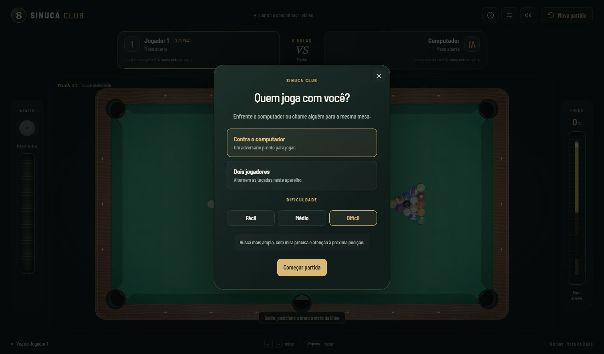
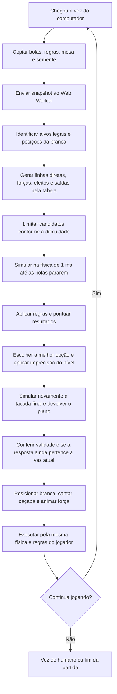

# Computador: pipeline de decisão e execução

O modo contra o computador roda inteiramente no aparelho. Não usa modelo de linguagem, chave de API ou serviço pago. O jogador humano controla o lado 1; o computador, o lado 2. `Nova partida` permite escolher o modo local e três dificuldades. A aplicação abre contra o computador no nível médio.





## Busca

O planejador está em `packages/core/src/ai/planner.ts`. Recebe um snapshot e não altera o estado original. Para cada alvo legal, calcula posições de bola fantasma em direção às seis caçapas. Filtra bolas no caminho e valida o primeiro contato com `predictShot`. Testa forças diferentes, além de efeito vertical nos níveis médio e difícil. Com bola na mão, considera posições alinhadas ao alvo e uma grade de recuperação dentro da área permitida.

Também considera contatos de defesa e saídas pela tabela. Estas últimas usam alvos espelhados com compensação da restituição da borracha e uma amostragem angular de recuperação. Toda alternativa é conferida pela simulação real e pelo `ShotRecorder`.

| Nível   | Limite de alternativas simuladas |  Erro máximo de mira | Variação máxima de força |
| ------- | -------------------------------: | -------------------: | -----------------------: |
| Fácil   |                               18 |  ±0,012 rad (~0,69°) |                      ±6% |
| Médio   |                               36 |  ±0,004 rad (~0,23°) |                    ±2,5% |
| Difícil |                               64 | ±0,0008 rad (~0,05°) |                    ±0,8% |

Há uma simulação adicional da tacada escolhida depois de aplicar os erros. Eles são reproduzíveis com a mesma semente e podem causar faltas, inclusive no nível difícil.

A pontuação prioriza vitória, penaliza derrota antecipada na 8, faltas e branca na caçapa, recompensa bolas do próprio grupo e considera a disponibilidade de contatos na próxima vez. Quando passa a vez, prefere deixar menos contatos visíveis ao adversário. Essa avaliação de posição é uma heurística de uma tacada; não é uma busca estratégica de várias jogadas.

## Worker e controlador

- `apps/web/src/ai/computer.worker.ts`: executa a busca isolada da interface.
- `apps/web/src/ai/workerClient.ts`: cria e termina o worker. O Vite o incorpora também na compilação de HTML único.
- `GameController`: reconhece a vez do computador, bloqueia comandos humanos, valida os parâmetros, posiciona a branca e executa a tacada após 0,85 s de preparação. A busca consome o mesmo relógio de 30 segundos.

Cada busca recebe uma geração interna. Reiniciar, pausar, trocar de modo, terminar uma vez ou desmontar a aplicação cancela o worker e invalida respostas antigas. Ao retomar, uma nova busca usa a mesa atual. Falha ou espera de 8 segundos ativa um plano geométrico sem simulações; se nem esse plano existir, o relógio resolve a vez. Isso evita prender o jogo em uma busca que não termina.

## Executar a validação

```bash
npm run check
npm run ai:benchmark
npm run build
npm run build:single
npm run dev
```

O benchmark executa até oito tacadas por nível, com semente 2026, usando o planejador nos dois lados. Confere as posições da branca, se cada tacada termina e se o resultado previsto coincide com a execução física. Gera `docs/ai-benchmark.json` com tempo médio, simulações, bolas encaçapadas e faltas. É um ensaio curto de integração, não uma medida de taxa de vitória ou desempenho em celular. A CI executa esse mesmo fluxo, exceto o servidor de desenvolvimento.

Os testes cobrem encaçapadas nos três níveis, saída, bola na mão, vitória com a 8, escape pela tabela, determinismo, imutabilidade, bloqueio dos comandos humanos, execução assíncrona, continuidade da vez, cancelamento, respostas antigas e recuperação de falhas do worker. O worker é substituído por um dublê nos testes de seu ciclo de vida; o teste no navegador verifica a integração real.

## Limites desta versão

Não há aprendizado por partidas, busca profunda, planejamento explícito de combinações ou tabelas para encaçapar. As saídas por tabela e a defesa são aproximações avaliadas pela física. Não há garantia de encontrar uma jogada legal em toda posição possível. O nível difícil é um adversário de busca limitada, não um jogador perfeito.
